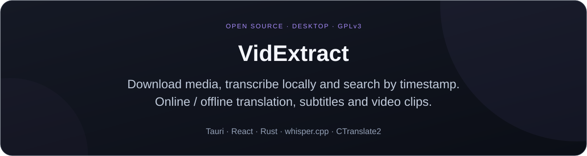
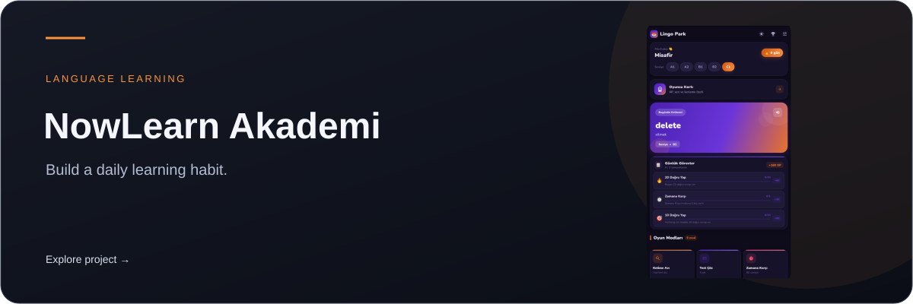
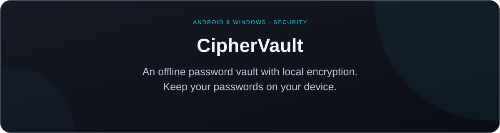
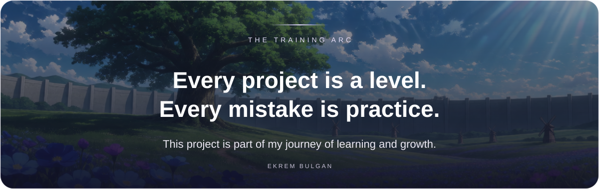

<a href="README.md">English</a> &nbsp; / &nbsp; <a href="README.tr.md">Türkçe</a>

  

<h1 align="center">Ekrem Bulgan</h1>

<strong>Applied AI · Mobile apps · Cross-platform development</strong>

<a href="https://www.ekrembulgan.com">Portfolio</a> &nbsp; / &nbsp;
<a href="https://linkedin.com/in/ekrembulgan">LinkedIn</a> &nbsp; / &nbsp;
<a href="https://buymeacoffee.com/ekrembulgan">Support my work</a>

 

I'm a Forensic Informatics Engineering graduate building mobile apps with Flutter 
and working toward a career in AI engineering.

My interests are computer vision and natural language processing. 
I want to turn models into useful applications people can use every day.

 

<h2 align="center">Selected projects</h2>

<a href="https://github.com/idginity124/VidExtract/releases">Download</a> &nbsp; / &nbsp; <a href="https://github.com/idginity124/VidExtract">Source code</a>

 

<a href="https://apps.microsoft.com/detail/9NK6QQKSLSHD">Microsoft Store</a> &nbsp; / &nbsp; <a href="https://github.com/idginity124/Zleno">Explore project</a>

 

<a href="https://apps.apple.com/tr/app/now-learn-akademi/id6803083436">App Store</a> &nbsp; / &nbsp;
<a href="https://play.google.com/store/apps/details?id=com.lingopark.app">Google Play</a> &nbsp; / &nbsp;
<a href="https://nowlearnakademi.com/">Website</a> &nbsp; / &nbsp;
<a href="https://github.com/idginity124/NowLearn-Akademi">Project showcase</a>

 

<a href="https://github.com/idginity124/CipherVault">Explore project</a>

 

<h2 align="center">AI studies</h2>

<strong>Airplane &amp; Bird Detection</strong> Computer vision work on real-time airplane and bird detection.

<strong>Named Entity Recognition</strong> Natural language processing work on extracting named entities from text.

Currently developing my skills in data preparation, model training and evaluation.

 

<h2 align="center">Tools I work with</h2>

<strong>AI &amp; computer vision</strong> Python · TensorFlow · OpenCV

<strong>Mobile &amp; desktop</strong> Flutter · Dart · Tauri · React · Rust

 

Other work: <a href="https://github.com/idginity124/MediaManagerPro">MediaManagerPro</a>

<h2 align="center">Get in touch</h2>

For mobile development, AI integration and Python automation projects:

<a href="https://linkedin.com/in/ekrembulgan">LinkedIn</a> &nbsp; / &nbsp;
<a href="https://www.upwork.com/freelancers/~01ada95984844a48c9">Upwork</a> &nbsp; / &nbsp;
<a href="https://www.fiverr.com/s/zWEbKZb">Fiverr</a> &nbsp; / &nbsp;
<a href="https://bionluk.com/ekrembulgan">Bionluk</a>

 

