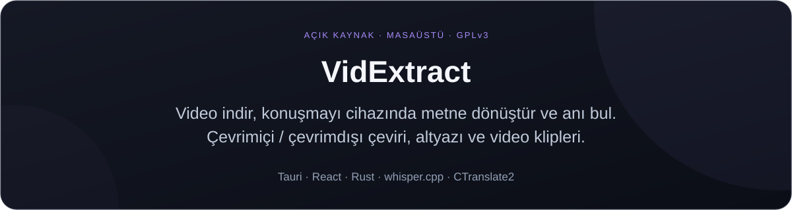
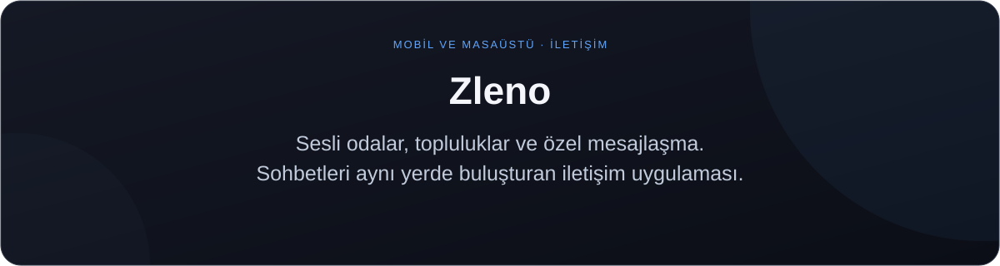
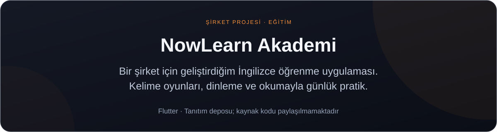
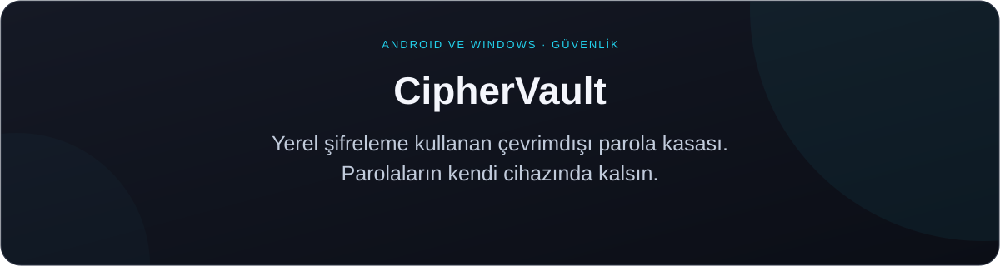

<a href="README.md">English</a> &nbsp; / &nbsp; <a href="README.tr.md">Türkçe</a>

  

<h1 align="center">Ekrem Bulgan</h1>

<strong>Yapay zekâ · Mobil uygulamalar · Çoklu platform geliştirme</strong>

  <a href="https://www.ekrembulgan.com">Portfolyo</a> &nbsp; / &nbsp;
  <a href="https://linkedin.com/in/ekrembulgan">LinkedIn</a> &nbsp; / &nbsp;
  <a href="https://buymeacoffee.com/ekrembulgan">Çalışmalarıma destek ol</a>

 

Adli Bilişim Mühendisliği mezunuyum. Flutter ile mobil uygulamalar geliştiriyor, 
kariyerimi yapay zekâ mühendisliği yönünde ilerletiyorum.

Bilgisayarlı görü ve doğal dil işleme üzerine çalışıyorum. 
Hedefim, modelleri insanların günlük yaşamında kullanabileceği uygulamalarla buluşturmak.

 

<h2 align="center">Seçili projeler</h2>

<a href="https://github.com/idginity124/VidExtract/releases">İndir</a> &nbsp; / &nbsp; <a href="https://github.com/idginity124/VidExtract">Kaynak kod</a>

 

<a href="https://apps.microsoft.com/detail/9NK6QQKSLSHD">Microsoft Store</a> &nbsp; / &nbsp; <a href="https://github.com/idginity124/Zleno">Projeyi incele</a>

 

<a href="https://apps.apple.com/tr/app/now-learn-akademi/id6803083436">App Store</a> &nbsp; / &nbsp;
<a href="https://play.google.com/store/apps/details?id=com.lingopark.app">Google Play</a> &nbsp; / &nbsp;
<a href="https://nowlearnakademi.com/">Web sitesi</a> &nbsp; / &nbsp;
<a href="https://github.com/idginity124/NowLearn-Akademi">Proje tanıtımı</a>

 

<a href="https://github.com/idginity124/CipherVault">Projeyi incele</a>

 

<h2 align="center">Yapay zekâ çalışmaları</h2>

<strong>Airplane &amp; Bird Detection</strong> 
Gerçek zamanlı uçak ve kuş tespiti üzerine görüntü işleme çalışması.

<strong>Adlandırılmış Varlık Çıkarma — NER</strong> 
Metinlerden adlandırılmış varlıkların çıkarılması üzerine doğal dil işleme çalışması.

Veri hazırlama, model eğitimi ve değerlendirme becerilerimi geliştiriyorum.

 

<h2 align="center">Kullandığım teknolojiler</h2>

<strong>Yapay zekâ ve görüntü işleme</strong> 
Python · TensorFlow · OpenCV

<strong>Mobil ve masaüstü</strong> 
Flutter · Dart · Tauri · React · Rust

 

Diğer çalışmalar: <a href="https://github.com/idginity124/MediaManagerPro">MediaManagerPro</a>

<h2 align="center">İletişim</h2>

Mobil uygulama, yapay zekâ entegrasyonu ve Python otomasyonu projeleri için:

<a href="https://linkedin.com/in/ekrembulgan">LinkedIn</a> &nbsp; / &nbsp;
<a href="https://www.upwork.com/freelancers/~01ada95984844a48c9">Upwork</a> &nbsp; / &nbsp;
<a href="https://www.fiverr.com/s/zWEbKZb">Fiverr</a> &nbsp; / &nbsp;
<a href="https://bionluk.com/ekrembulgan">Bionluk</a>

 

  

